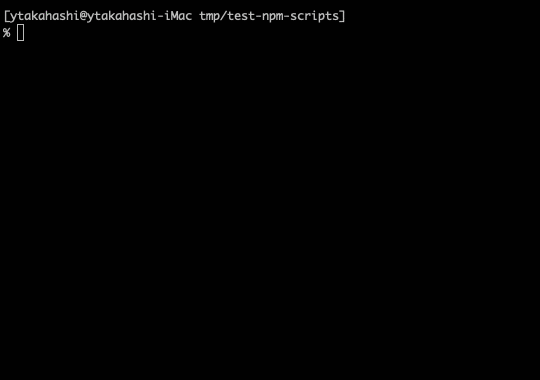

<!-- deno-fmt-ignore-file -->

# nps

[](https://deno.land/x/nps)
[](https://github.com/ytakahashi/nps)
[](https://opensource.org/licenses/MIT)
[](https://github.com/ytakahashi/nps/actions/workflows/deno.yml)

Interactive npm-scripts runner for Node.js projects.



## Install

```terminal
deno install --global --allow-read --allow-run --allow-env https://deno.land/x/nps/nps.ts
```

## Update

```terminal
deno install --global --force --reload --allow-read --allow-run --allow-env https://deno.land/x/nps/nps.ts
```

## Usage

Run following command in Node.js project.

```terminal
nps
```

The package manager is selected from the current directory in this order:

1. `package.json`'s `devEngines.packageManager.name`.
2. `package.json`'s `packageManager` field.
3. Lockfiles: `bun.lock`, `bun.lockb`, `package-lock.json`, `yarn.lock`, and `pnpm-lock.yaml`.

See `nps -h` for details.

### Filter npm-scripts

If an argument is provided, scripts are filtered by the value and prompt shows filtered items.  
If given value matches only one script, the command is run immediately.

### Pass arguments to command

Arguments after double dash (`--`) are treated as script command option like [npm run](https://docs.npmjs.com/cli/v7/commands/npm-run-script).  
All the arguments after the `--` are passed directly to selected script.

### zsh completion

`nps` can add package.json script completion to `npm run`, `npm run-script`, `pnpm run`, `yarn run`, and `bun run`.

Add the following line to your `.zshrc`.

```terminal
eval "$(nps --init-completion zsh)"
```

After setup, script names are completed from the current directory's `package.json`.
